# shinyGizmo

[](https://img.shields.io/static/v1.svg?label=github.com&message=v.0.1&color=ff69b4)
[](https://lifecycle.r-lib.org/articles/stages.html#stable)

## Overview

shinyGizmo fills the gaps between what Shiny offers out of the box and
what real-world applications need. It provides ready-to-use components
that give you finer control over inputs, keep large applications
responsive and let you build dynamic, adaptive interfaces - all from R,
without writing JavaScript.

- **Take control over inputs** - merge controllers into a single input,
  detect whether a value was changed by the user or by an `update*`
  call, block unwanted updates, or grab any DOM value on demand.
- **Use widgets missing in Shiny** - select values in many groups at
  once, or pass large texts to the server only when needed.
- **Build modern layouts** - responsive grids with CSS Container
  Queries, lightweight accordions and modals defined directly in UI.
- **Make UI react on the browser side** - run conditional JavaScript
  actions and animations without a round trip to the server.

<center>

## <span style="color:blue"> shinyGizmo 0.6.0 is now available!</span>

</center>

## Installation

From CRAN:

    install.packages("shinyGizmo")

Latest development version from Github:

    remotes::install_github(
      "r-world-devs/shinyGizmo"
    )

## Available components

### Input control

Decide when and how input values reach the server.

#### `commonInput(s)` - merge multiple input controllers into one

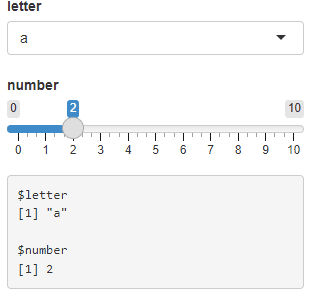

#### `controlInput` - control how input value is sent to the server

Wrap any input controller to find out whether its value was changed by
the user or programmatically (with `update*` functions), block sending
the value depending on the change source, or attach custom attributes to
the value.

``` r
ui <- fluidPage(
  controlInput(selectInput("letter", "Letter", letters), attributes = list(group = "form")),
  controlInput(numericInput("number", "Number (program updates blocked)", value = 1), block = "program"),
  controlInput(dateInput("date", "Date (user changes blocked)", value = Sys.Date()), block = "user"),
  actionButton("update", "Update programmatically"),
  verbatimTextOutput("out")
)

server <- function(input, output, session) {
  output$out <- renderPrint({
    str(list(letter = input$letter, number = input$number, date = input$date))
    cat("Date trigger:", attr(input$date, "trigger"))
  })
  observeEvent(input$update, {
    updateSelectInput(session, "letter", selected = sample(letters, 1))
    updateNumericInput(session, "number", value = sample(1:10, 1))
    updateDateInput(session, "date", value = Sys.Date() + sample(1:10, 1))
  })
}
```

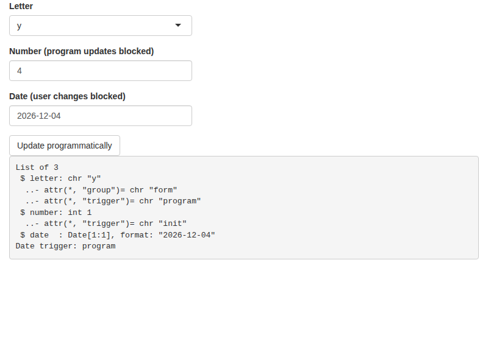

The `"trigger"` attribute is one of `"init"`, `"user"` or `"program"`.
Original input handlers are still applied, so e.g. `dateInput` value is
a `Date` object. See `examples/controlinput.R` for the full app.

#### `valueButton` - get any attribute from Shiny application DOM objects

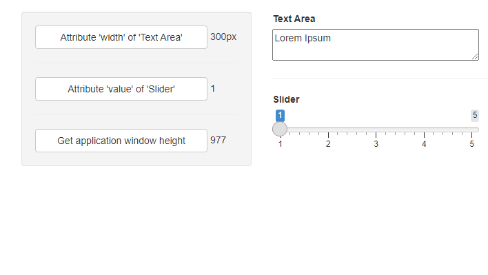

### Input widgets

Controllers not available in Shiny.

#### `pickCheckboxInput` and `vsCheckboxInput` - make selection in many groups at once

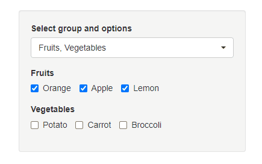

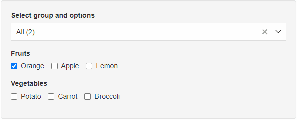

#### `textArea` - non-binding version of `shiny::textAreaInput`.

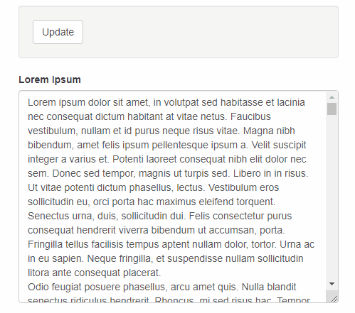

Improves application performance when large amount text is passed to
text area. Works great with `valueButton`.

### Layout and containers

Structure the application UI.

#### `container` + `grid` - responsive layouts with CSS Container Queries

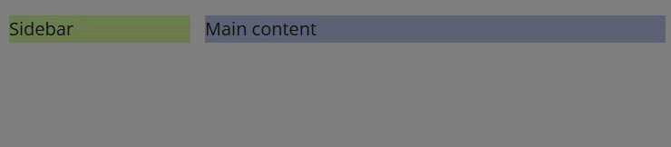

Build responsive layouts that adapt based on the container’s own
dimensions rather than the viewport using [CSS Container
Queries](https://developer.mozilla.org/en-US/docs/Web/CSS/CSS_containment/Container_queries)
and [CSS Grid
Layout](https://developer.mozilla.org/en-US/docs/Web/CSS/CSS_grid_layout).
Combine `container()` with `condition()` to define CSS rules at
different breakpoints, and use `grid()` / `grid_item()` as composable
helpers for CSS Grid layouts.

``` r
 container(
  name = "dashboard",
  color = "#b5c5e7ff",
  div(class = "sidebar", "Sidebar", style = "background-color:#d4f89b;") |> grid_item(area = "sidebar"),
  div(class = "main", "Main content", style = "background-color:#b5c5e7;") |> grid_item(area = "main"),
  conditions = list(
    condition(
      !!!grid(
        template_areas = list(c("sidebar", "main")),
        template_columns = "200px 1fr",
        gap = "16px"
      ), 
      `font-size` = "20px"
    ),
    condition(
      query = "width < 700px",
      !!!grid(
        template_areas = list(c("sidebar"), c("main")),
        gap = "12px"
      ), 
      `font-size` = "12px"
    )
  )
)
```

Key features:

- **`container()`** - wraps elements with `container-type` /
  `container-name` for CSS Container Queries
- **`condition()`** - defines CSS rules for a specific container query
  (or unconditionally when `query = NULL`); supports `.extra_css` for
  targeting child selectors
- **`grid()`** - generates CSS Grid properties (`template_areas`,
  `template_columns`, `auto_fill`, etc.) as a named list for splicing
  into `condition()` via `!!!`
- **`grid_item()`** - pipe-friendly helper to set `grid-area`,
  `grid-row`, `grid-column` on individual elements

See `examples/container.R` for a full demo app with nested containers,
auto-fill grids, and explicit row/column spanning.

#### `accordion` - light and simple version of accordion

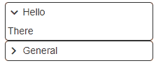 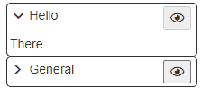

#### `modalDialogUI` - create modals directly in UI

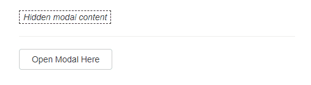

### Dynamic UI

Change UI on the browser side, based on application state.

#### `conditionalJS` - extended version of `shiny::conditionalPanel`.

Allows to attach conditional JavaScript action to be run on UI element.

Use predefined actions such as `disable`, `attachClass`, `css`, `show`,
`runAnimation` or define a custom one.

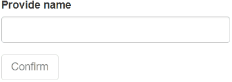 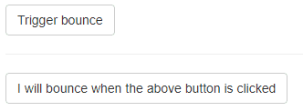

Attach multiple rules to a single element by applying `conditionalJS`
multiple times, or by passing vectors of conditions and calls:

``` r
tags$button("Bold when value at least 5, disabled when locked") |>
  conditionalJS("input.value >= 5", jsCalls$attachClass("boldme")) |>
  conditionalJS("input.lock", jsCalls$disable())

conditionalJS(
  tags$button("Visible when value at least 3, red when at least 7"),
  condition = c("input.value >= 3", "input.value >= 7"),
  jsCall = list(jsCalls$show(), jsCalls$css(color = "red"))
)
```

## Lifecycle

shinyGizmo is stable but we’re still developing the package. If you find
bugs or have any suggestions for future releases post an issue on GitHub
page at <https://github.com/r-world-devs/shinyGizmo/issues>.

## Getting help

There are two main ways to get help with `shinyGizmo`

1.  Reach the package author via email: <krystian8207@gmail.com>.
2.  Post an issue on our GitHub page at
    [https://github.com/r-world-devs/shinyGizmo](https://github.com/r-world-devs/shinyGizmo/issues).
